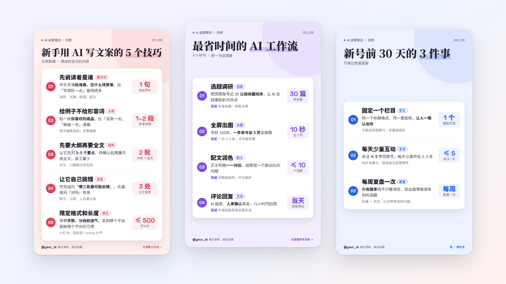
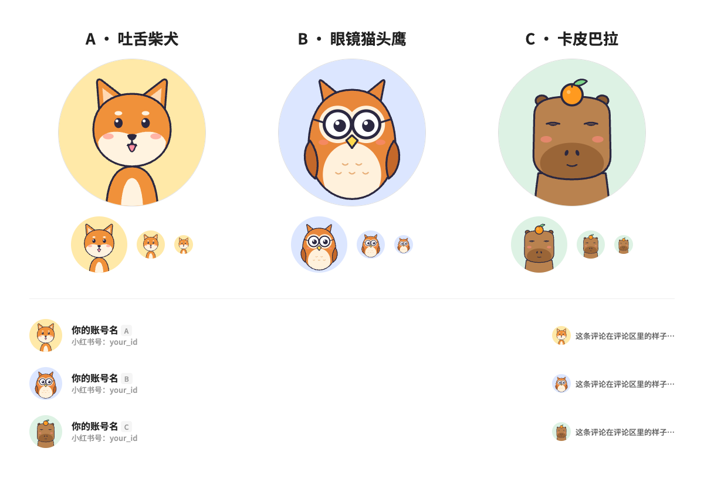

<div align="center">

# rednote-skills

**Let your AI agent run a Xiaohongshu (RedNote) account**: images, captions, publishing, daily engagement and avatar design, one sentence away in Claude Code, Codex or Cursor.

[](LICENSE)
[](https://skills.sh/wxd56987/rednote-skills)
[](https://www.agensi.io/learn/skill-md-format-reference)

[简体中文](README.md) · English



<sub>Three pages rendered by <code>rednote-fullscreen-note</code> in one command (sample data from <code>assets/example-data.json</code>).</sub>

</div>

## What it does

Once installed, just ask your agent:

| You say | Skill | Result |
|---|---|---|
| "Turn these 5 news items into Xiaohongshu list images" | `rednote-fullscreen-note` | 3 full-screen pages, 1300×2160 at 300ppi, auto-fitted font size |
| "Write the caption for these images" | `rednote-caption-writer` | Title, body and ≤10 topics, checked against platform rules |
| "Publish it, private first" | `rednote-publish` | Full-screen long-article post; picks the most-viewed exact-match topics |
| "Do today's Xiaohongshu engagement" | `rednote-growth-ops` | Browse, like, follow ≤5 peers; comment drafts for you to approve |
| "Design a cartoon avatar for me" | `rednote-profile-branding` | 3 mascot avatars previewed at the real list and comment sizes |

## Install

**Claude Code (plugin)**

```
/plugin marketplace add wxd56987/rednote-skills
/plugin install rednote-skills@rednote-skills
```

All five skills are installed together. Call one by name, e.g. `/rednote-skills:rednote-publish`, or just describe what you want.

**Any agent (skills.sh)**

```bash
npx skills add wxd56987/rednote-skills
```

Works with Claude Code, Codex, Cursor, Gemini CLI, Copilot and more. Add `-s rednote-publish` to install a single skill.

**Manual**

```bash
git clone https://github.com/wxd56987/rednote-skills.git
cp -R rednote-skills/skills/rednote-* ~/.claude/skills/
```

## The five skills

| Skill | What it covers | Needs |
|---|---|---|
| [`rednote-fullscreen-note`](skills/rednote-fullscreen-note/SKILL.md) | Items → 9.6:16 list pages that fill the phone screen, 5 per page. Editorial look: pastel background, left-aligned serif headline, one white sheet with divided rows, one accent color per page, themeable. | Node 22+, Chrome |
| [`rednote-caption-writer`](skills/rednote-caption-writer/SKILL.md) | Title formula, a body that maps to the images, a save / question / follow closing, a topic mix, and a compliance check | — |
| [`rednote-publish`](skills/rednote-publish/SKILL.md) | Publishes through the creator platform's long-article route; the regular image upload squeezes tall images into 3:4. Removes template images, matches topics exactly, defaults to private, and can swap images on a published note. | A browser-automation tool that can upload local files (e.g. Claude in Chrome) |
| [`rednote-growth-ops`](skills/rednote-growth-ops/SKILL.md) | A human-paced daily routine for new accounts: ≤5 follows and 2–3 comments (you approve each one), a log, and notes on what peers' hits have in common | A browser-automation tool |
| [`rednote-profile-branding`](skills/rednote-profile-branding/SKILL.md) | Replaces wordmark avatars, which read as company accounts, with an expressive mascot. Starter shiba, owl and capybara, previewed at 56px and 32px. | Node 22+, Chrome |

The pipeline for one note:

```
material ─▶ fullscreen-note (data.json → PNG) ─▶ caption-writer (caption.md) ─▶ publish (private → you make it public)
daily: growth-ops            once: profile-branding
```

<details>
<summary>Avatar starter preview</summary>



</details>

## Where the rules come from

Every rule was learned on a live account:

- The regular image upload letterboxes 9.6:16 images into 3:4; only the long-article route shows them full-screen.
- A note takes at most 10 topics, and the first dropdown suggestion for `#ai` is usually not #ai itself.
- The avatar can be changed only 3 times in 7 days.
- The web app and the creator platform need separate logins.
- A new account that follows too many people or leaves low-effort comments gets throttled as spam.

Details live in each skill's `references/`.

## Safety

- No secrets or account data. You log in yourself in the browser; the skills never type passwords.
- **Network:** rendering downloads fonts from Google Fonts; browser actions stay on xiaohongshu.com. Nothing else is sent anywhere.
- **You approve what goes out:** posts are private by default, and every comment or reply is shown to you before sending. Making notes public and deleting them stay with you.
- No mass following, fake likes or off-platform funnels.

## Roadmap & contributing

- [ ] Post analytics (views, saves, follower growth vs. topic)
- [ ] Drafted replies for your own comment section
- [ ] More list layouts and color themes
- [ ] Video note covers

Issues and PRs welcome. Add a skill as `skills/<name>/SKILL.md` and run `sh scripts/package.sh` to check the format. If this helps you, a ⭐ helps others find it.

## License

[MIT](LICENSE)
